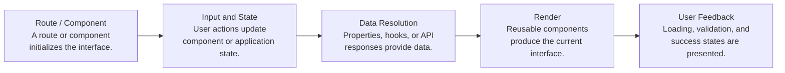

# Toque chef hire

A React Router marketplace application for browsing chef services and managing hiring workflows.

## Overview

The repository contains an implemented application or analysis project with code organized around its primary runtime, interface, data, or automation responsibilities.

## Key Features

- Component-based interface
- Client-side state and event handling
- Reusable layout and feature modules
- Responsive browser presentation

## Technology Stack

| Area | Technology |
|---|---|
| Platform | Node.js |
| Library / Framework / Tool | React |
| Library / Framework / Tool | Vite |
| Library / Framework / Tool | Tailwind CSS |
| Library / Framework / Tool | React Router |
| Library / Framework / Tool | TypeScript |
| Library / Framework / Tool | CSS |
| Platform | Docker |

## Architecture and Data Flow

| Stage | Responsibility |
|---|---|
| **Route / Component** | A route or component initializes the interface. |
| **Input and State** | User actions update component or application state. |
| **Data Resolution** | Properties, hooks, or API responses provide data. |
| **Render** | Reusable components produce the current interface. |
| **User Feedback** | Loading, validation, and success states are presented. |

## Repository Structure

- `.agents`
- `.dockerignore`
- `.gitignore`
- `.vscode`
- `app`
- `Dockerfile`
- `documentation.md`
- `package-lock.json`
- `package.json`
- `public`
- `react-router.config.ts`
- `tsconfig.json`
- `vercel.json`
- `vite.config.ts`

## Setup

1. Install Node.js and npm.
2. Run `npm install` from the repository root.
3. Start the project with the applicable script below.

## Usage

- `npm run build` — react-router build
- `npm run dev` — react-router dev
- `npm run start` — react-router-serve ./build/server/index.js
- `npm run typecheck` — react-router typegen && tsc

## Configuration

Review `package.json` for available scripts and runtime dependencies. Add environment variables locally only when a feature requires external credentials or service configuration.

## Verification

- `npm run build` — react-router build
- `npm run typecheck` — react-router typegen && tsc
