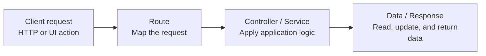

# Toque chef hire

**Portfolio project** · A full-stack React Router application for chef hiring and marketplace workflows.

## Overview

A full-stack React Router application for chef hiring and marketplace workflows.

## Technology Stack

- `Node.js`
- `React`
- `Vite`
- `Tailwind CSS`
- `TypeScript`
- `CSS`

## How the Repository Works

| Stage | Responsibility |
|---|---|
| **Client request** | HTTP or UI action |
| **Route** | Map the request |
| **Controller / Service** | Apply application logic |
| **Data / Response** | Read, update, and return data |

## Concepts Covered

- Component-based UI
- State and props
- Event handling
- Reusable layout
- Client-side rendering

## Repository Map

- `.agents`
- `.dockerignore`
- `.gitignore`
- `.vscode`
- `app`
- `Dockerfile`
- `documentation.md`
- `package-lock.json`
- `package.json`
- `public`
- `react-router.config.ts`
- `tsconfig.json`

## Recruiter Summary

This repository demonstrates practical implementation skills, repository organization, and an end-to-end understanding of the project workflow. It is suitable as a focused example of applied software or data work.

---

Documentation is concise and project-focused; source code was not modified.
